# Sonora

Sonora es una aplicación web para explorar y reproducir música, hecha con Laravel, Blade y Tailwind CSS siguiendo el sistema de diseño Sonora establecido. La reproducción es simulada: sin audio, solo un temporizador que avanza según el progreso de cada canción.

**Materia:** Programación Web

## Requisitos

- PHP 8.2 o superior
- Composer
- Node.js 18 y npm
- Laravel Herd (o cualquier servidor local para Laravel).

## Cómo ejecutarlo

1. Clone o descargue el proyecto y entre a su carpeta.
2. Instale las dependencias.

```bash
   composer install
   npm install
```

3. Prepare el entorno:

```bash
   cp .env.example .env
   php artisan key:generate
```

4. Compile los estilos y el JS (deje esta terminal abierta):

```bash
   npm run dev
```

5. Abra el sitio en el navegador de su preferencia. Con Herd, la dirección es el nombre de la carpeta con la terminación `.test`. Sin Herd, ejecute `php artisan serve` en otra terminal y entre a `http://localhost:8000`.

El proyecto no usa base de datos. Las canciones y las playlists son datos inventados que se encuentran en `routes/web.php`.

## Pantallas

| Ruta           | Vista                   | Qué muestra                                              |
| -------------- | ----------------------- | -------------------------------------------------------- |
| `/`            | `inicio.blade.php`      | Chips de filtro, playlists y canciones recientes         |
| `/buscar`      | `buscar.blade.php`      | Buscador que filtra canciones, y playlists para explorar |
| `/playlist`    | `playlist.blade.php`    | Cabecera de la playlist y su lista de canciones          |
| `/reproductor` | `reproductor.blade.php` | Portada grande, controles y cola                         |

## Funciones

- Reproducir y pausar
- Siguiente y anterior
- Reproducción aleatoria
- Seleccionar una canción desde cualquier lista
- Barra de progreso
- Volumen con barra de progreso y botón de silencio
- Favorito y filtros con estado activo
- Búsqueda de canciones
- Tema claro y oscuro
- La reproducción continúa al cambiar de pantalla

## Estructura

```
resources/
  css/app.css                ->   Tokens del sistema de diseño y fuentes
  js/app.js                  ->   Reproductor simulado y controles
  views/
    layouts/app.blade.php    ->   Layout compartido: navegación y barra del reproductor
    components/              ->   button, chip, icon, card, song_row, progress_bar, search_field
routes/web.ph                ->   Rutas y datos de ejemplo
```

## Componentes

Se reutilizaron los componentes del sistema de diseño: `button` (primario, secundario y fantasma), `chip`, `icon` y `card` (tarjeta con portada), además de `song_row` para las filas de canciones. Se crearon `progress_bar`, que sirve para el progreso y el volumen, y `search_field`.

## Capturas de pantalla

### Inicio

<p>
  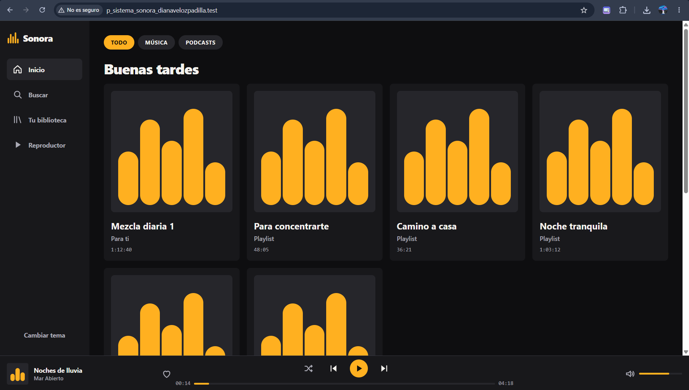
  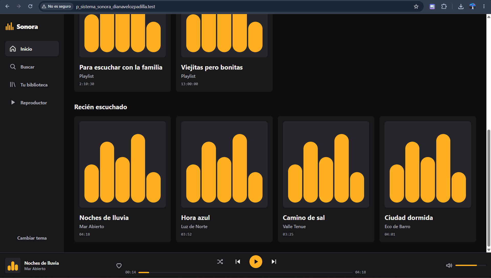
  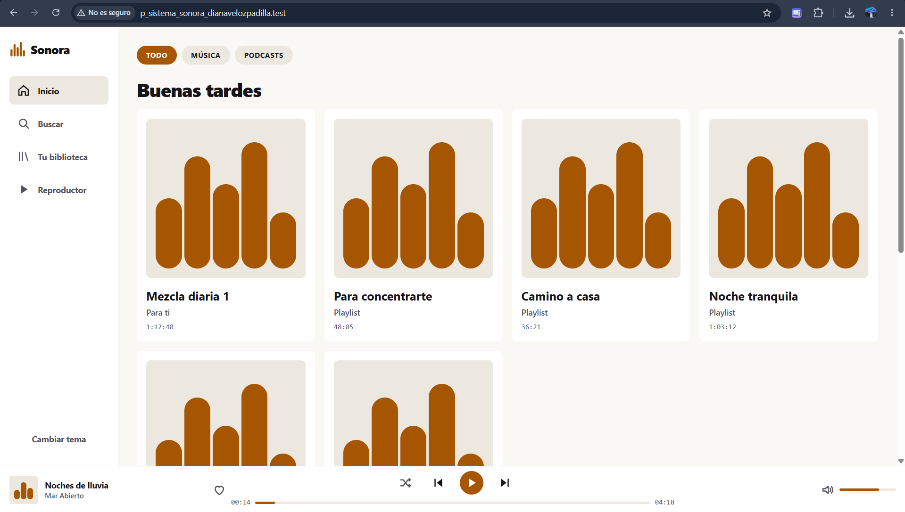
  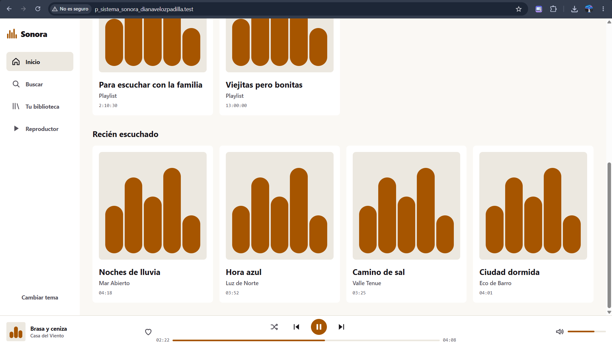
</p>

### Buscar

<p>
  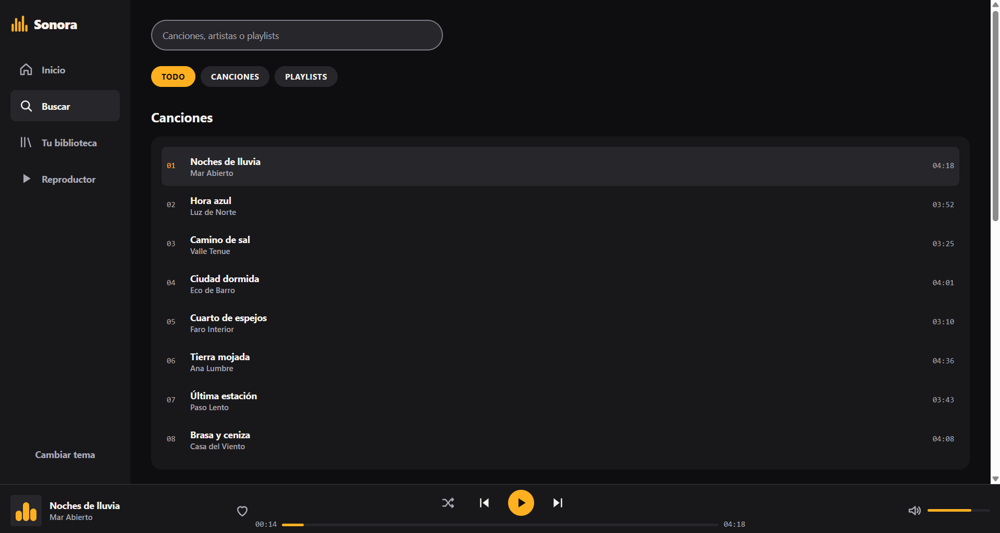
  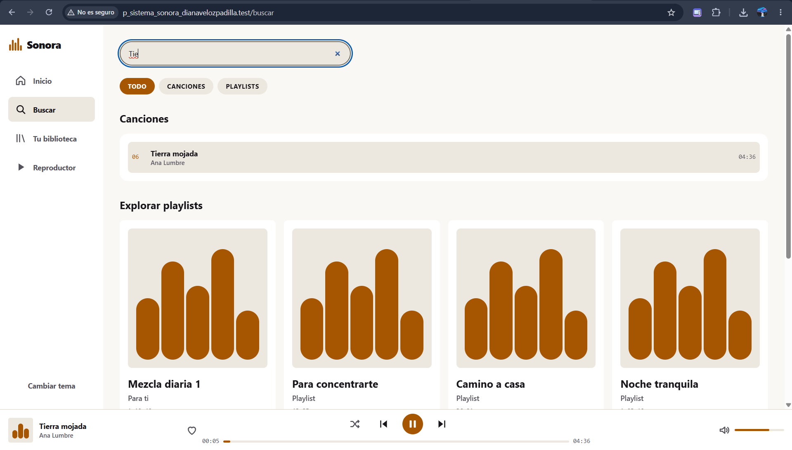
</p>

### Playlist

<p>
  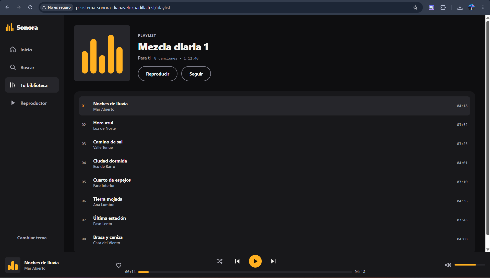
  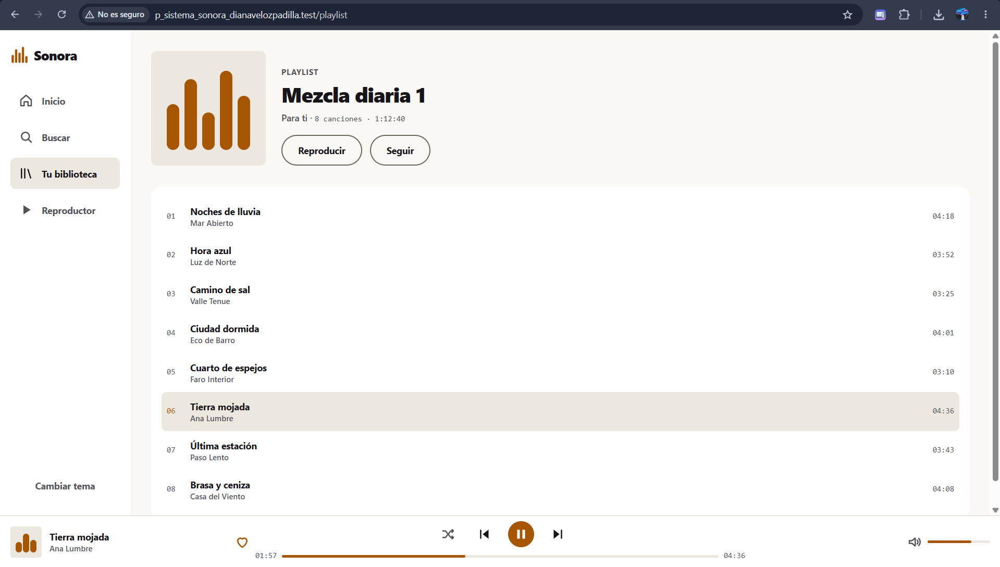
</p>

### Reproductor

<p>
  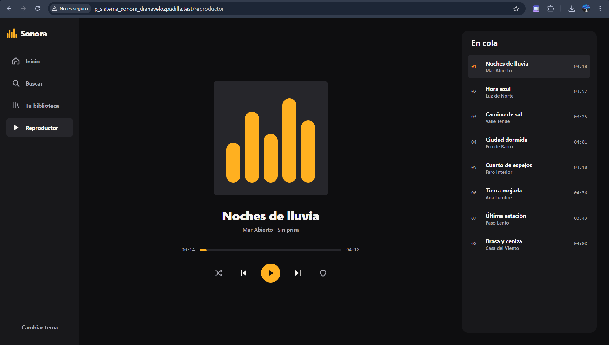
  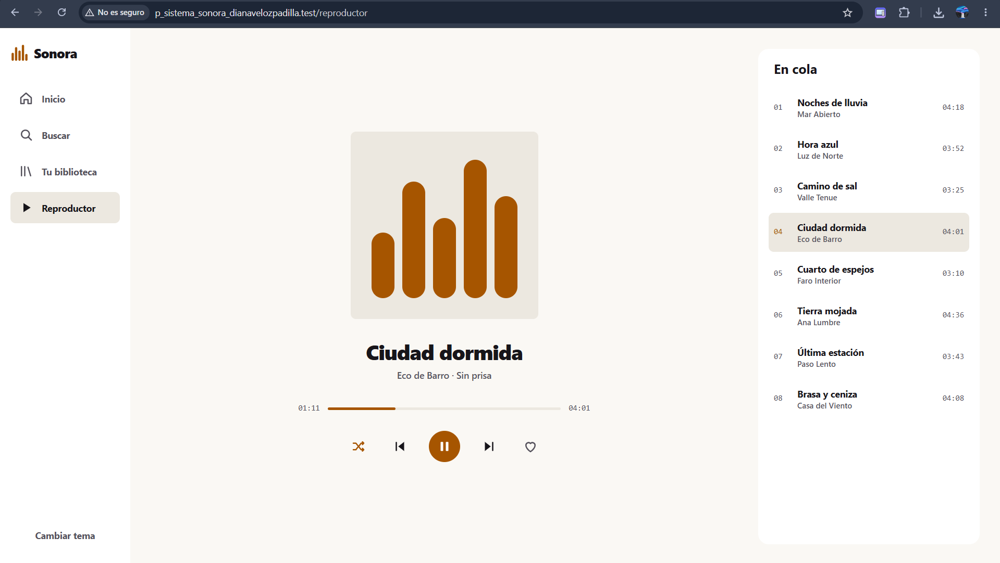
</p>

### Responsividad

<p>
  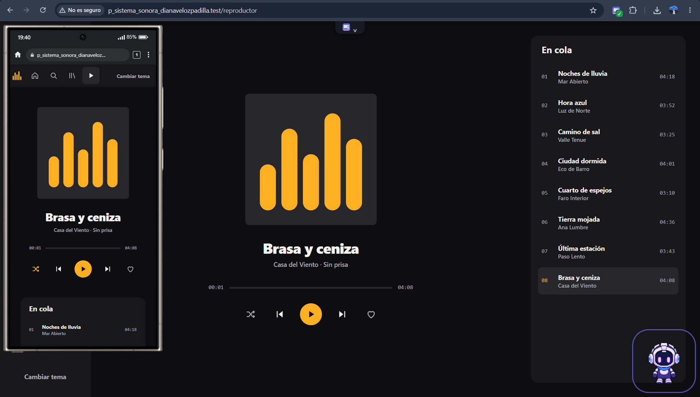
  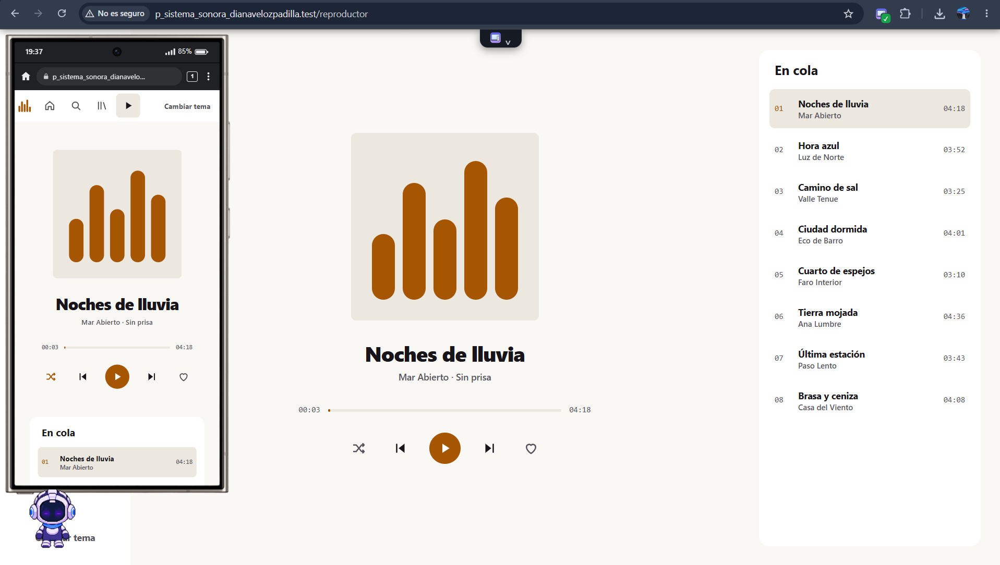
</p>

## Decisiones

**Qué se reutilizó:** los componentes del docente para botones, chips, iconos, tarjetas y filas de canciones, y el código base del reproductor simulado.

**Qué se agregó:** una barra de progreso interactiva que se reutiliza para el volumen, el buscador, el modo aleatorio, la memoria entre pantallas y el layout compartido.

**Qué cambiaría:** guardar las canciones en una base de datos, usar imagenes en lugar de iconos para las portadas de las playlists y que los filtros de los chips si muestren el contenido.
